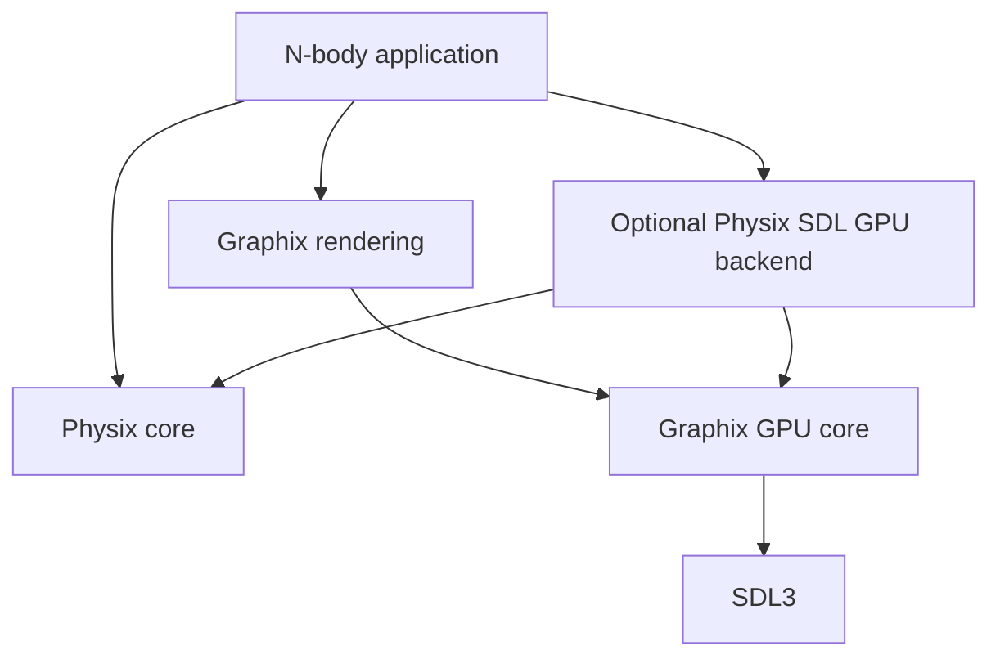

# Graphix, Physix, and the simulation application

This is the target structure for growing the working two-body demo into an
N-body application. Only the first build separation is implemented now:
`graphix.cpp` builds as `Graphix::Core`, and the existing demo runner links to it.
The folders and types below describe subsequent extractions, not existing APIs.

## 1. Responsibility boundaries

| Part | Owns | Does not decide |
| --- | --- | --- |
| Graphix GPU core | SDL window/device, GPU resource creation, shader loading, pipeline creation, uploads/downloads, command submission | Gravity, body layout, timestep, simulation rules |
| Graphix rendering | Camera/projection, meshes, sphere and line rendering, lighting, halos, render targets | Mass, acceleration, integration, physical orbital predictions |
| Physix core | `Vec3`, `Body`, gravity, integration, simulation time, initial-condition math, physical diagnostics | SDL windows, colors, pixels, input |
| Optional Physix SDL GPU backend | GPU body layout/buffers, gravity shaders, integration dispatches, unit conversion, physics readback | Camera, visible body radius, drawing, user input |
| N-body application | Scenario, input bindings, playback clock, display settings, selection of solver and render passes, physical-to-visual mapping | Generic GPU allocation or a second copy of the gravity algorithm |

The GPU backend belongs to the physics side because its shader contains physics.
It is a separate optional build target: Physix core remains usable without SDL
or Graphix. Initially, keep that backend in the N-body application until its
interface works; extract it when another application needs it.

## 2. Dependency direction



An arrow means “uses.” Graphix has no dependency on Physix. Physix core has no
dependency on Graphix. The optional backend can use Graphix's GPU helpers without
making the numerical library depend on graphics. CPU and GPU solvers are
alternative execution paths; stepping both is a verification mode, not playback.

## 3. Folder layout to grow toward

Keep the real Graphix repository root at `graphix/sdl` during this work. Avoid a
simultaneous repository move, include-path migration, and renderer rewrite.

```text
graphix/sdl/
  include/graphix/
    gpu/
      context.h          window, device, and their lifetime
      buffer.h           buffers and transfer operations
      shader.h           graphics shader loading and compute pipeline loading
      pipeline.h         graphics pipeline configuration
      frame.h            acquire, submit, present, and resize handling
    render/
      camera.h           graphics camera and projection math
      mesh.h             vertex/index storage and sphere geometry
      sphere_renderer.h  reusable sphere rendering
      line_renderer.h    ordinary/dotted world-space lines
  src/gpu/               implementations of the GPU helpers
  src/render/            implementations of reusable renderers
  shaders/render/        generic sphere, line, and halo shaders
  demos/                 small SDL GPU learning examples
  docs/
  CMakeLists.txt

physix/
  include/               keep the current headers initially
    vec3.h
    body.h
    physix.h
    physix_calulations.h
    physix_constants.h
  impl/                  existing numerical implementations
  gpu/sdl/               optional later extraction
    gpu_body.h           explicit CPU/HLSL-compatible storage layout
    nbody_solver.h       initialize, step, reset, inspect GPU state
    nbody_solver.cpp
    shaders/             gravitational acceleration and integration
  tests/                 physics tests, including optional GPU comparisons

nbody application/      the existing two-body-gpu project can grow into this
  main.cpp               event loop, scheduling, compute/render ordering
  scenario.cpp           choose masses, positions, velocities
  body_display.h         colors and visual radii, separate from physical Body
  gpu_nbody_solver.*     first home for the optional backend above
  orbit_history.*        sample actual trajectories for this application
  shaders/
    body_render.vert.hlsl  adapter that understands the GPU body layout
```

These are logical groups, not a requirement to create every wrapper immediately.
One GPU header/source pair is fine while the implementation is small. Leave
`Demo` and arrow-key demo options in the demos, not in the public library API.

The current standalone showcase draws spheres analytically in its fragment
shader. Extract that working approach first if it suits the N-body view. The
mesh-based sphere path above is an option for a broader renderer, not a reason
to rewrite the showcase before it can be reused.

## 4. Different pipelines are expected

Graphix provides resource and pipeline construction. A renderer or simulation
module owns the specific pipeline it needs.

| Pipeline | Owner | Inputs and output |
| --- | --- | --- |
| N-body gravity/integration compute | Physics GPU backend | Body state and timestep → next body state |
| Sphere graphics | Graphix rendering, configured by the app | Geometry, camera, display data → colored spheres |
| Dotted-path graphics | Graphix line renderer | Sampled world-space positions, style, camera → dotted lines |
| Future cellular-automata compute | Its own simulation module | Current cells and rule parameters → next cells |

Do not store one universal `currentPipeline` inside the library and make every
simulation conform to it. Each pass binds the pipeline and resources it needs.
Start with SDL's pipeline descriptions and small helpers; a large pipeline
inheritance hierarchy is unnecessary.

## 5. Body data and rendering data

Keep `Body` focused on physics: name, mass, position, velocity. Store color and
visual radius in the application's display settings. A visual radius does not
become a collision radius or gravitational softening length implicitly.

The GPU solver owns its GPU state buffers. The renderer borrows buffer handles
for a pass; it neither frees them nor modifies the physical state. A public
Graphix interface should not require `Physix::Body` or an N-body storage layout.

For direct GPU rendering, the application owns a small adapter vertex shader
that reads the physics buffer and produces the sphere-rendering inputs. Graphix
provides the mesh, camera, reusable shading, and pipeline tools. This preserves
the demo's compute-to-render path without downloading body positions to the CPU.
If the renderer later needs one standard instance layout, add a GPU conversion
pass from physics records to rendering records. Keep that mapping in the app or
adapter, rather than teaching Graphix about mass and velocity.

Positions can use the existing double-precision Physix vectors on the CPU and
explicit aligned float records on the GPU. The backend owns unit conversion and
packing. Do not copy `Body` directly into GPU storage: it includes `std::string`
and is not a shader-compatible record.

## 6. Time, history, and a frame

The application owns wall-clock elapsed time, pause state, playback speed, and
the fixed-step accumulator. It requests a number of steps at the physical
timestep. The solver owns physical state and simulated elapsed time. Graphix
neither advances physics nor changes the timestep.

One displayed frame proceeds as follows:

1. Application reads input and updates camera or playback settings.
2. Application calculates how many fixed physics steps are due.
3. Physics backend records those integration dispatches in a command buffer.
4. Application records trajectory samples and any rendering-data conversion.
5. Graphix records sphere and dotted-line rendering using the updated data.
6. The command buffer is submitted and the image is presented.

GPU steps must use consistent old/new states. The current demo safely handles
two bodies in a single invocation. A general N-body solver cannot simply assign
one thread to each body while overwriting a shared state buffer. Use separate
current/next buffers and ordered integration stages so every body sees the same
state for each acceleration evaluation. Buffer cycling is resource management;
it is not a replacement for logical current/next simulation state.

The application initially owns orbital history because it chooses what to
record and how often. Graphix draws any supplied points; it does not predict
orbits. A later reusable trajectory recorder may move to Physix if it is also
used for numerical analysis or export.

## 7. Resource lifetime

- Context owns window/device. Create it first and destroy it last.
- GPU solver owns body buffers and compute pipelines.
- Each renderer owns its meshes, graphics pipelines, and render targets.
- Application owns the context, solver, renderers, camera, scenario, and controls.
- Rendering references to solver buffers are borrowed, with compatible usage
  flags and an agreed shader layout.
- Reset updates solver state and explicitly clears application history; it does
  not recreate the GPU device.

Use scoped C++ resource owners as code is extracted. Centralize release behavior
so copying a wrapper cannot accidentally create two owners of one SDL handle.

## 8. Build targets and extraction order

Implemented now: `Graphix::Core` (`graphix_core`, a static library) contains the
current `graphix.cpp`; `main` links to it. The current public `graphix.h` is a
compatibility entry point. Existing demos and shader-copy behavior are preserved.

Later targets:

- `Graphix::Render` links to `Graphix::Core`, never Physix.
- A Physix core target contains only numerical code. The existing `physix`
  static-library target is the starting point; make SDL-dependent examples
  optional so configuring the numerical library does not require a local SDL checkout.
- An optional Physix SDL GPU target links to Physix core and Graphix GPU core.
- An N-body executable links the rendering and solver targets it uses.

Extraction order:

1. Separate library and demo build targets — done.
2. Split context/shader/buffer helpers when the compute example needs them.
3. Extract camera and sphere rendering from the working two-body demo.
4. Extract dotted-line drawing, retaining recording policy in the app.
5. Give the GPU solver a small initialize/step/reset/readback interface.
6. Generalize that solver to N bodies and verify it against CPU Physix.
7. Extract the optional physics GPU module once its interface is actually reused.

For every step, keep a runnable example. Verify GPU math with CPU-reference
comparisons and conservation checks. Check graphics through the demos and the
two-body view. A large engine, ECS, plugin system, or universal simulation base
class is not needed for this structure.
